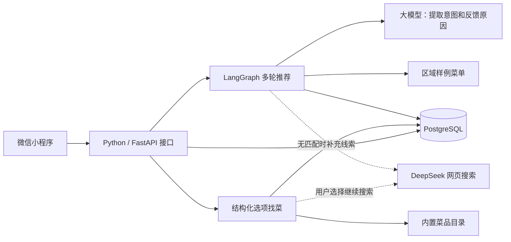

# Food Agent 微信小程序 · 离线演示

「食觅啊」是一个帮用户决定这顿吃什么的 Agent。用户可以用自然语言描述地点、预算和口味，也可以跟着选项一步步找菜，再用反馈调整候选。

本仓库提供微信小程序和本地模拟接口。下面也说明原项目的 Agent 架构，便于理解小程序里的操作分别对应哪些后端流程。

## 开始体验

1. 在微信开发者工具中导入本目录。项目配置使用游客 AppID `touristappid`。如果工具要求选择 AppID，请选择测试号或填写自己的小程序 AppID。
2. 编译后输入演示码 `DEMO`。它只是用来展示原有的进入流程。
3. 在首页输入「预算 25 元，想吃清淡一点」，或者用「选项找菜」选择口味或输入「番茄鸡蛋面」。
4. 打开「口味画像」，修改并保存示例内容。再次打开页面可看到保存结果，也可撤销示例商家的屏蔽。退出演示会清除进入状态，画像会保留在本地。清除小程序的数据缓存可恢复初始画像。

## 原项目的架构

**FastAPI** 接收小程序请求并校验用户。**LangGraph** 编排对话推荐和推荐反馈。模型通过 OpenAI 兼容接口把用户输入解析成结构化意图，默认模型服务是 DeepSeek。Python 代码负责读数据、应用预算和忌口等条件、计算排序并组织结果。

### 对话推荐与反馈

例如，输入「我在杭州滨江，25 元以内，想吃清淡一点」，原系统按以下顺序处理：

1. 小程序给这顿饭生成一个 `session_id`，通过 `POST /recommend` 发送用户输入。同一顿饭的后续消息沿用这个 ID。
2. `parse_turn` 调用模型提取本餐条件，并识别用户是否要求记住、更正或删除长期偏好。`save_memory` 处理识别出的长期偏好变更。
3. `load_preferences` 读取已保存的画像，把常用地点作为本餐地点的备选。缺少地点或口味需要澄清时，返回追问。
4. `query_candidates` 按区域读取样例菜单。当前样例菜单覆盖杭州滨江。`filter_and_rank` 先排除超预算、与忌口冲突或来自已屏蔽商家的菜品，再按菜系、口味、目标价和历史反馈等信号排序。
5. `finish_turn` 返回候选和推荐编号。样例菜单没有匹配项时，可生成搜索词，并在配置支持时补充网页线索。样例价格和网页线索都需要用户自行核实。
6. 用户选择、喜欢、嫌贵或屏蔽商家时，小程序通过 `POST /feedback` 发送推荐编号和候选编号。工作流验证反馈对应的推荐轮次，写入反馈记录，并按动作返回确认、追问或更新候选。

### 选项找菜

小程序负责问答顺序，将菜名、口味、食材和其他条件整理成结构化请求，发送到 `POST /guided-meal`。这条流程独立于 LangGraph 对话推荐图。

原后端结合画像中的口味和忌口，先筛选 PostgreSQL 菜品目录。未配置目录数据库或读取出错时，使用内置的种子菜品。目录没有匹配项时，小程序给出调整条件或继续联网搜索的选项。联网查询需要配置 DeepSeek，返回的是带来源的菜品线索。

### 数据库和会话

| 保存位置 | 数据 | 用途 |
| --- | --- | --- |
| PostgreSQL · 用户与画像 | 测试用户、邀请码摘要、口味画像、常用地点和已屏蔽商家 | 跨餐保存长期偏好，供后续推荐读取 |
| PostgreSQL · 菜品目录 | 菜名、典型食材、别名和分类标签 | 为选项找菜提供可筛选的候选 |
| PostgreSQL · 推荐反馈 | 反馈动作及对应的推荐快照 | 统计历史反馈，为后续排序提供信号 |
| LangGraph 进程内存 | 本餐意图、候选和当前推荐快照 | 用用户 ID 和 `session_id` 隔离每顿饭的多轮状态。服务重启后需要重新开始本餐 |
| 后端 JSON 文件 | 区域样例菜单、种子菜品 | 分别用于对话推荐的样例匹配和菜品目录回退 |

原后端通过 SQLAlchemy 和 psycopg 访问 PostgreSQL。仓库里的离线演示只使用微信本地存储保存演示进入状态和口味画像。

## 从哪里读代码

| 文件 | 职责 |
| --- | --- |
| [`pages/meal/meal.js`](pages/meal/meal.js) | 本餐会话、发消息、显示推荐、提交反馈，以及推进选项问答 |
| [`pages/meal/guided.js`](pages/meal/guided.js) | 定义问答顺序，将选择归入口味、口感、主食等筛选条件 |
| [`api.js`](api.js) | 在小程序进程内接收上述路径，用固定菜单和简单规则模拟响应，保存演示画像 |
| [`pages/profile/profile.js`](pages/profile/profile.js) | 读取、编辑画像及撤销商家屏蔽 |

## 演示与原系统的区别

| 操作 | 本仓库的行为 |
| --- | --- |
| 输入用餐需求 | 用有限的关键词和价格规则筛选固定菜单 |
| 选项找菜 | 用部分条件筛选菜名、口味和食材，补充候选由本地模拟生成 |
| 反馈和口味画像 | 屏蔽商家、编辑画像会写入小程序本地存储，其他反馈演示返回确认的流程 |

商家、菜品价格和初始画像均为虚构数据。FastAPI 后端、LangGraph 工作流和 PostgreSQL 属于原系统。体验这个小程序副本无需启动后端、配置数据库或填写 API Key。
